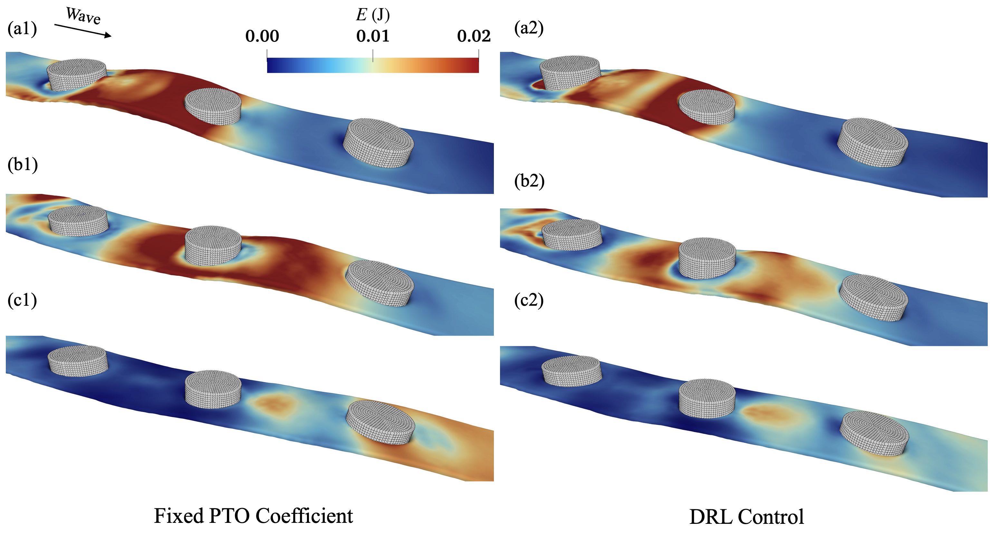
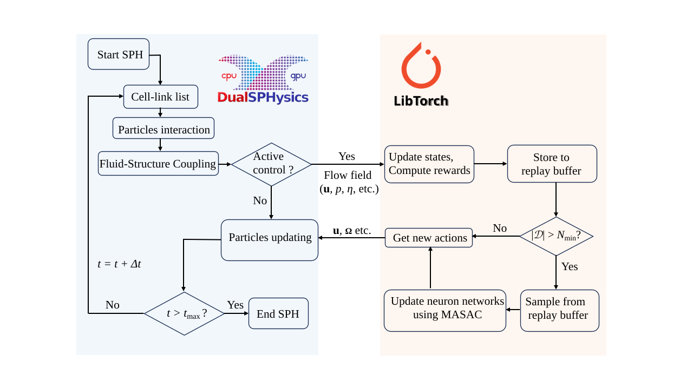

# SPH-MADRL: Coupled Smoothed Particle Hydrodynamics with Multi-Agent Deep Reinforcement Learning for Wave Energy Converters

<!-- [](https://opensource.org/licenses/MIT) -->
[](https://developer.nvidia.com/cuda-toolkit)
[](https://www.linux.org/)

> A fully integrated, GPU-accelerated 3D framework coupling high-fidelity SPH simulations with Multi-Agent Soft Actor-Critic (MASAC) reinforcement learning for cooperative control of point absorber wave energy converter arrays.


**Wave energy distribution under 3D irregular wave conditions**
<p align="center">
  
</p>


<!-- ## 📄 Reference

**Zhan et al. (2026)** — *Coupling Smoothed Particle Hydrodynamics with Multi-Agent Deep Reinforcement Learning for Cooperative Control of Point Absorbers*  
arXiv: [2601.06485](https://arxiv.org/abs/2601.06485)

**Authors:** Yi Zhan, Iván Martínez-Estévez, Min Luo, Alejandro J.C. Crespo, Abbas Khayyer

--- -->

## 🌊 Overview

Wave Energy Converters (WECs), particularly point absorbers (PAs), are promising devices for ocean wave energy harvesting. However, achieving high conversion efficiency remains challenging due to complex nonlinear wave–structure interactions.

This project presents an **SPH–MADRL** coupled framework that:
- Uses high-fidelity **Smoothed Particle Hydrodynamics (SPH)** to simulate wave–structure interactions
- Applies **Multi-Agent Soft Actor-Critic (MASAC)** reinforcement learning for real-time adaptive control
- Dynamically optimises the **Power Take-Off (PTO) damping coefficient** of each device
- Supports **multi point absorbers** in both 2D regular and 3D irregular wave conditions
- Achieves up to **23.8% improvement** in energy capture over constant PTO baselines

---

## ✨ Key Features

- **Two-way SPH–DRL coupling**: Real-time exchange of hydrodynamic states and control actions in memory (no serialisation overhead)
- **Centralised Training, Decentralised Execution (CTDE)**: Agents share a centralised critic during training but execute independently
- **GPU-accelerated C++ implementation**: Both SPH and neural network training run on GPU via CUDA + LibTorch
- **Multi-agent cooperative control**: MASAC algorithm handles non-stationarity across multiple interacting devices
- **Open-source**: All coupling models, algorithms and training tools will be released

---

## 🏗️ Architecture



### Agent Observation Space (per device)

| Variable | Description |
|----------|-------------|
| `η_{i,1..4}` | Wave elevations at 4 gauges around device |
| `Dη/Dt` | Temporal derivatives of wave elevations |
| `v_z^{n-1}` | Heave velocity (previous timestep) |
| `Δz_i` | Heave displacement from initial position |
| `a_z,i` | Heave acceleration |

### Action Space

Each agent outputs a scalar `o_i ∈ [-1, 1]`, mapped to:

```
k_{p,i} = k_base + o_i × Δk_max,   Δk_max = 0.9 × k_base
```

---

## 📊 Results Summary

### 2D Regular Waves

| Scenario | Total Energy (DRL) | Total Energy (Baseline) | Improvement |
|----------|-------------------|------------------------|-------------|
| 1 PA     | 39.16 J           | 35.87 J                | **+9.2%**   |
| 2 PAs    | 30.42 J           | 25.58 J                | **+18.9%**  |
| 3 PAs    | 23.47 J           | 18.95 J                | **+23.8%**  |

### 3D Irregular Waves (3 PAs)

| Agent | Energy (DRL) | Energy (Baseline) | Improvement |
|-------|-------------|-------------------|-------------|
| PA₁   | 89.03 J     | 64.64 J           | **+37.7%**  |
| PA₂   | 49.00 J     | 42.34 J           | **+15.7%**  |
| PA₃   | 30.38 J     | 31.66 J           | -4.0%       |
| Total | 168.42 J    | 138.64 J          | **+21.5%**  |

> Note: PA₃ slight decrease reflects the reward design prioritising array-level efficiency; upstream devices absorb most available energy.

---

## ⚙️ Numerical Methods

### SPH Model (`δR-SPH`)

- **Kernel**: 5th-order C² Wendland kernel
- **Time integration**: Symplectic position Verlet scheme
- **Wave generation**: Piston-type wave maker (regular & irregular via JONSWAP spectrum)
- **Boundary conditions**: Multi-layer dummy particles (Adami et al., 2012)
- **Stability**: CFL condition with `C_CFL = 0.2`
- **Enhancements**: VEM + HPDC divergence cleaning schemes

### MASAC Hyperparameters

| Parameter | Value |
|-----------|-------|
| Optimiser | Adam |
| Batch size | 128 |
| Replay buffer | 10⁵ |
| Actor LR | 0.003 |
| Critic LR | 0.003 |
| Hidden layers | 3 × [128, 128, 64] |
| Discount factor γ | 0.99 |
| Target smoothing τ | 0.005 |
| Activation | ReLU |

---

## 🖥️ Computational Performance

Tested on a micro-workstation with NVIDIA RTX 4090:

| Case | Particles | Sim. Time | Runtime |
|------|-----------|-----------|---------|
| 2D regular (3 PAs) | 151,230 | 1000 s | 9.49 h |
| 3D irregular (3 PAs) | 1,973,090 | 1000 s | 37.51 h |

SPH computations dominate runtime (~82–88%); DRL overhead is minimal with the compact 3-layer network used.

---

## 🔧 Dependencies

| Component | Version / Details |
|-----------|------------------|
| SPH Solver | DualSPHysics+ (extended DualSPHysics) |
| DRL Library | LibTorch (PyTorch C++ API) 2.8.0 |
| CUDA | 12.8 |
| Compiler | g++ 11.4, nvcc 12.8.93 |
| Parallel | CUDA 12.8, OpenMP 4.5 |
| OS | Ubuntu 20.04 LTS |

---

<!-- ## 🚀 Getting Started

> ⚠️ Full open-source release is forthcoming. The framework will be released to support reproducibility and further development.

### Prerequisites

```bash
# CUDA toolkit (12.x recommended)
# LibTorch C++ distribution
# DualSPHysics+ (extended solver)
```

### Build

```bash
git clone https://github.com/<repo>/SPH-MADRL-WEC.git
cd SPH-MADRL-WEC
mkdir build && cd build
cmake .. -DCMAKE_PREFIX_PATH=/path/to/libtorch
make -j$(nproc)
```

### Run a Training Case

```bash
# 2D regular wave, 3 point absorbers
./sph_madrl --config configs/2D_3PA_regular.json --gpu 0

# 3D irregular wave, 3 point absorbers
./sph_madrl --config configs/3D_3PA_irregular.json --gpu 0
```

---

## 📁 Repository Structure

```
SPH-MADRL-WEC/
├── src/
│   ├── sph/              # SPH solver (DualSPHysics+ core)
│   ├── drl/              # MASAC implementation (LibTorch)
│   └── coupling/         # SPH-DRL coupling interface
├── configs/              # Case configuration files
│   ├── 2D_3PA_regular.json
│   └── 3D_3PA_irregular.json
├── scripts/              # Pre/post-processing utilities
├── validation/           # Benchmark validation cases
└── README.md
```

---

## 📝 Citation

If you use this framework in your research, please cite:

```bibtex
@article{zhan2026sph,
  title   = {Coupling Smoothed Particle Hydrodynamics with Multi-Agent Deep 
             Reinforcement Learning for Cooperative Control of Point Absorbers},
  author  = {Zhan, Yi and Mart{\'i}nez-Est{\'e}vez, Iv{\'a}n and Luo, Min and 
             Crespo, Alejandro J.C. and Khayyer, Abbas},
  journal = {arXiv preprint arXiv:2601.06485},
  year    = {2026}
}
```

---

## 🤝 Acknowledgements

- **DualSPHysics** team for the open-source SPH solver foundation
- **LibTorch** (PyTorch C++ API) for neural network infrastructure
- Experiments validated against data from Zang et al. (2018)

---

## 📬 Contact

**Corresponding author:** Min Luo — min.luo@zju.edu.cn  
State Key Laboratory of Ocean Sensing & Ocean College, Zhejiang University, Zhoushan, China -->